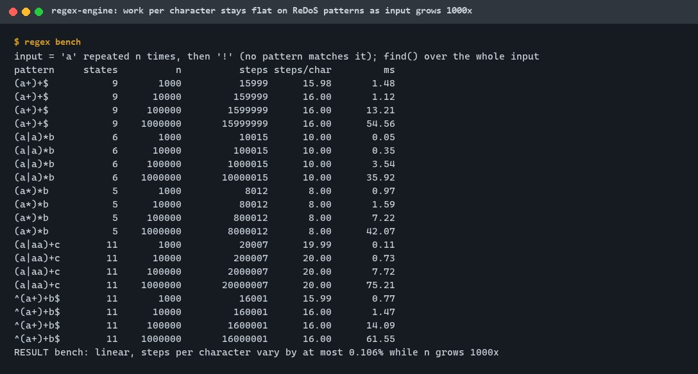
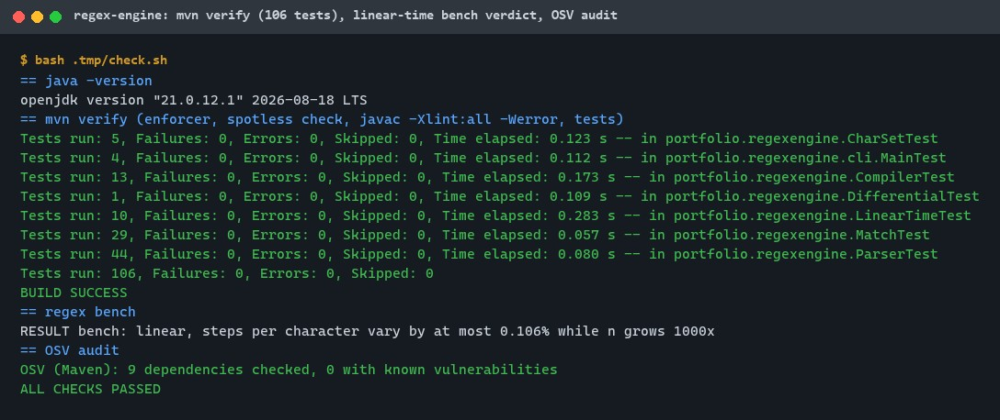
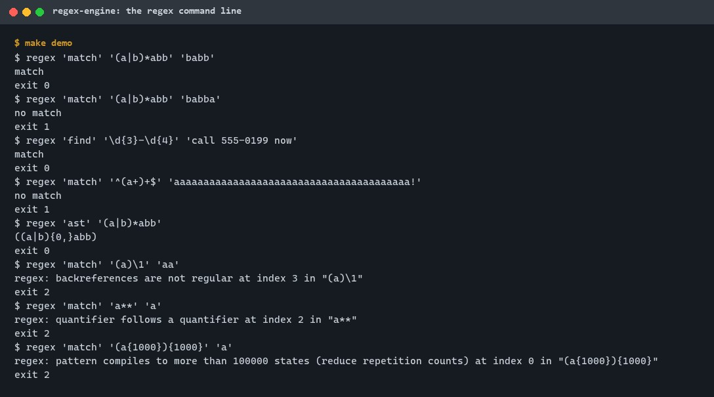
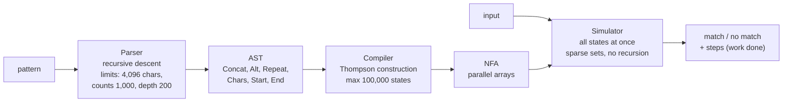
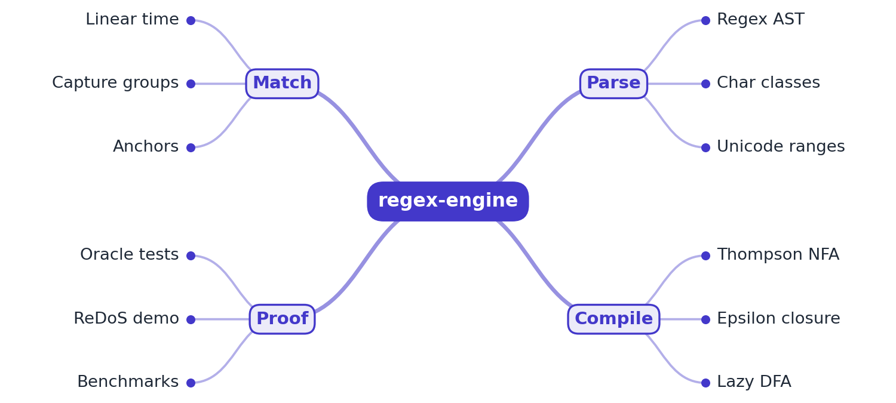

# regex-engine

[](https://github.com/EquinoxWN/regex-engine/actions/workflows/ci.yml)


> Why one bad regex can freeze a whole service (ReDoS), and how to make it impossible: a linear-time Thompson NFA engine that never backtracks.

Part of my **Distributed Systems & Storage** list · Java

## Proof it works

Five classic ReDoS patterns run against inputs of 1,000 to 1,000,000 characters that do not match.
The work per character stays flat (8 to 20 state visits, varying by at most 0.106%) while the input
grows 1,000 times; the million-character runs take 36 to 75 ms:



106 tests pass, including 87,440 comparisons with java.util.regex. javac (all warnings as errors)
and Spotless are clean, and the OSV audit finds no known vulnerabilities:



The command line answers match or no match, prints the parsed tree, and refuses patterns it cannot
match in linear time, naming the reason and the position:



## Architecture

**What M1 runs today:**



**Full roadmap (M1 to M3):**



## How it works

_Steps 1 and 2 are built and tested (M1); the rest is on the [roadmap](#roadmap)._

1. The pattern is parsed into an AST (concatenation, alternation, repetition, classes) and compiled into a Thompson NFA.
2. Matching simulates all NFA states in parallel, so run time is linear in input length whatever the pattern.
3. A lazy DFA caches state sets as they are discovered, giving DFA speed without building a possibly exponential automaton up front.
4. Capture groups run on a Pike VM that tracks the positions of each thread.
5. A backtracking matcher is included for contrast: `(a+)+$` takes seconds there and microseconds here.
6. Property tests check every match against java.util.regex as an oracle.

In M1, every input character moves every possible NFA state at once; duplicate states merge, so the
work per character is bounded by about twice the number of states
([ADR 0002](docs/adr/0002-simulate-the-nfa-instead-of-backtracking.md)). Patterns are bounded instead
of inputs ([ADR 0003](docs/adr/0003-bound-pattern-size-not-input-size.md)). Backreferences and
lookaround are refused because no finite automaton can match them.

## Who it helps

- **Who:** engineers who run regexes on untrusted input or accept patterns from users (search
  filters, log queries, validation rules), and security reviewers checking for ReDoS.
- **The problem:** backtracking engines can take exponential time on some pattern and input pairs,
  so one request can pin a CPU.
- **What M1 does:** a small Java library whose matching work is linear in the input for every
  pattern it accepts, with hard limits on pattern size, a step counter to prove the bound, and clear
  errors for unsupported syntax.
- **How to use it:** `Regex.compile(pattern).matches(input)` or `.find(input)`; `measure()` also
  returns the work done. Or from the shell: `regex match PATTERN TEXT`.

## Tech stack

| Area | In M1 | Planned |
|---|---|---|
| Engine | Java 21: recursive-descent parser, Thompson NFA, parallel simulation with sparse sets | Lazy DFA cache, Pike VM for captures (M2) |
| Contrast | Linear-scaling bench with a computed verdict | Plain backtracking matcher and log-scale chart (M3) |
| Tests | JUnit 6.1.3 (parameterized), java.util.regex on a fixed corpus of 87,440 comparisons | Random-pattern property tests over 100,000 patterns (M3) |
| Build | Maven 3.9: enforcer, Spotless (palantir-java-format), javac `-Xlint:all -Werror`, reproducible jar timestamp, OSV.dev audit | |

| Path | What it is |
|---|---|
| `Parser`, `Ast`, `CharSet` | Syntax, tree, character ranges |
| `Compiler`, `Nfa` | Thompson construction and the automaton (with Graphviz output) |
| `Simulator`, `Regex` | Parallel simulation and the public API |
| `cli/Main` | The `regex` command: match, find, ast, dot, bench |
| `scripts/osv_audit.py`, `scripts/demo.sh` | Dependency audit, CLI demo |

## Run it

Needs JDK 21+, Maven 3.9+, make and Python 3 (audit only).

```bash
make setup   # resolve dependencies
make lint    # enforcer, Spotless check, javac -Xlint:all -Werror
make test    # 106 tests
make bench   # steps per character on five ReDoS patterns, n = 1,000 to 1,000,000
make audit   # OSV.dev
make demo    # the command line
```

Or directly:

```bash
java -cp target/classes portfolio.regexengine.cli.Main match '(a|b)*abb' babb
java -cp target/classes portfolio.regexengine.cli.Main find '\d{3}-\d{4}' 'call 555-0199 now'
java -cp target/classes portfolio.regexengine.cli.Main dot 'a(b|c)*' > nfa.dot
```

Exit codes: 0 match, 1 no match, 2 refused pattern or bad usage. Supported: literals, `.`,
`[...]`, `[^...]`, `\d \w \s \D \W \S \t \n \r \f`, `(...)`, `(?:...)`, `|`, `* + ? {n} {n,} {n,m}`,
`^ $`.

## Tests and results

Latest local run (full detail in [docs/results/m1.md](docs/results/m1.md)):

| Test class | Tests | What it proves |
|---|---|---|
| `ParserTest` | 44 | 23 patterns parse to the expected tree; 20 bad patterns refused with the right reason and index; nesting and length limits |
| `CharSetTest` | 5 | Range merging, exact complement over all 65,536 units, binary search vs linear scan, built-in classes |
| `CompilerTest` | 13 | Thompson state counts, a connected automaton, the 100,000-state cap, `a{0}`, Graphviz output |
| `MatchTest` | 29 | 28 match and find cases; one regex shared by 4 threads |
| `LinearTimeTest` | 10 | Doubling the input doubles the work (within 1%) on 7 ReDoS patterns, under 2 x states per character; 1,000,000-character attacks finish within 5 s |
| `DifferentialTest` | 1 | 87,440 comparisons with java.util.regex (40 patterns x every string over {a,b,c} up to length 6 x matches and find), all equal |
| `cli.MainTest` | 4 | Exit codes, ast and dot, errors, bench verdict |

| Check | Result |
|---|---|
| Tests | 106 passed, 0 failed |
| Lint | javac `-Xlint:all -Werror` and Spotless clean |
| Audit | OSV.dev: 9 dependencies checked, 0 with known vulnerabilities |
| Linear scaling | steps per character vary by at most 0.106% from n = 1,000 to 1,000,000 on 5 patterns |
| Time at n = 1,000,000 | 36 to 75 ms per pattern (single runs on a shared laptop) |
| java.util.regex on 8 classic ReDoS patterns (n up to 25) | under 3 ms each in JDK 21 (it memoizes these loops), so M3 uses its own backtracking matcher for the contrast |

The full local check passed twice. CI fails the build unless the bench verdict is "linear".

## Roadmap

**M1** (≈8 h)
- [x] Write `docs/rfc/0001-design.md`: problem, goals, non-goals, chosen design
- [x] The pattern is parsed into an AST (concatenation, alternation, repetition, classes) and compiled into a Thompson NFA.
- [x] Matching simulates all NFA states in parallel, so run time is linear in input length whatever the pattern.

**M2** (≈8 h)
- [ ] A lazy DFA caches state sets as they are discovered, giving DFA speed without building a possibly exponential automaton up front.
- [ ] Capture groups run on a Pike VM that tracks the positions of each thread.

**M3** (≈9 h)
- [ ] A backtracking matcher is included for contrast: `(a+)+$` takes seconds there and microseconds here.
- [ ] Property tests check every match against java.util.regex as an oracle.
- [ ] Publish the proof below with real numbers

## Proof

What this repo must show before it counts as done:

- Log-scale chart of backtracking vs NFA time as input grows, and oracle agreement over 100k random patterns.

| Result | Value |
|---|---|
| Backtracking vs NFA chart | Not built yet (M3). M1 measures the NFA side: see [Tests and results](#tests-and-results). |
| Oracle agreement over 100k random patterns | Not built yet (M3). M1: 87,440 comparisons on a fixed corpus, all equal. |

## Why it matters

- **Interview angle:** Complexity and ReDoS questions in security and systems rounds.
- **Upstream I'd like to contribute to:** Google's RE2/J: tests and documentation.

## Design docs

- [RFC 0001: design](docs/rfc/0001-design.md)
- [ADR 0001: record architecture decisions](docs/adr/0001-record-architecture-decisions.md)
- [ADR 0002: simulate the NFA in parallel instead of backtracking](docs/adr/0002-simulate-the-nfa-instead-of-backtracking.md)
- [ADR 0003: bound the pattern, not the input](docs/adr/0003-bound-pattern-size-not-input-size.md)
- [M1 results](docs/results/m1.md)

## Scope

This is a learning and portfolio library, not a drop-in replacement for java.util.regex: it answers
whether a pattern matches, works on UTF-16 units, and refuses non-regular features.

## Security and contributing

- Linear-time matching for every accepted pattern; hard limits on pattern length, counts, nesting
  and automaton size; no recursion in matching.
- No runtime dependencies; Maven plugins pinned; every GitHub Action pinned to a commit SHA;
  workflows run read-only, without persisted credentials.
- Dependabot update pull requests are paused (`open-pull-requests-limit: 0`) so the repository keeps a single `main` branch; dependencies are updated by hand and checked by the CI audit.
- Report vulnerabilities privately: see [SECURITY.md](SECURITY.md). To contribute, see [CONTRIBUTING.md](CONTRIBUTING.md).

## License

MIT, see [LICENSE](LICENSE).
